# [Radar Communication Signal]MATLAB Code to Generate Different Standard Signals

Signal generation capabilities include:
%********************* Test signal generator *********************%
1 % FHSS signal;
2 % LFM signal, with controllable bandwidth;
3 % DSSS signal;
4 % Pulse CW signal;
5 % BPSK signal;
6 % CW Cosine signal;
7 % CW Sine signal;
8 % Pulse DSSS signal;
9 % Continuous FHSS continua;
otherwise %VCO signal, variable frequency.

## Images

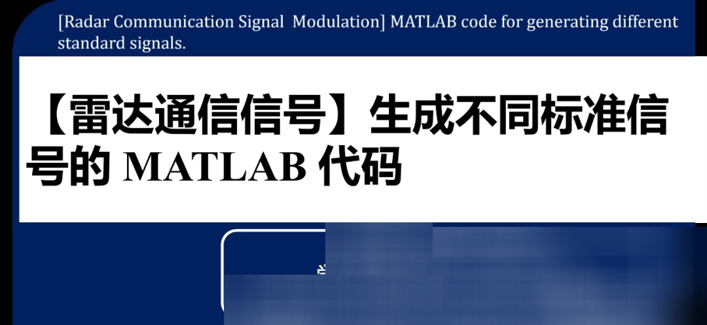
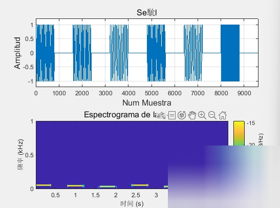
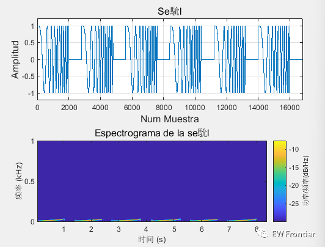
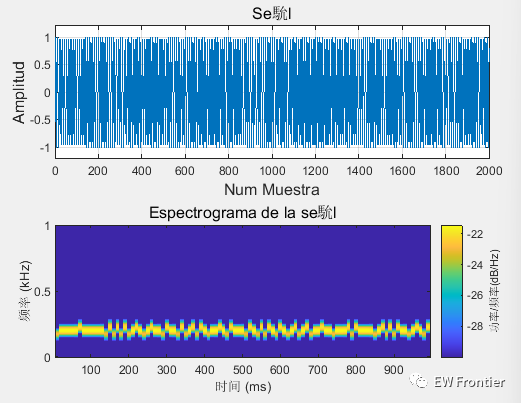
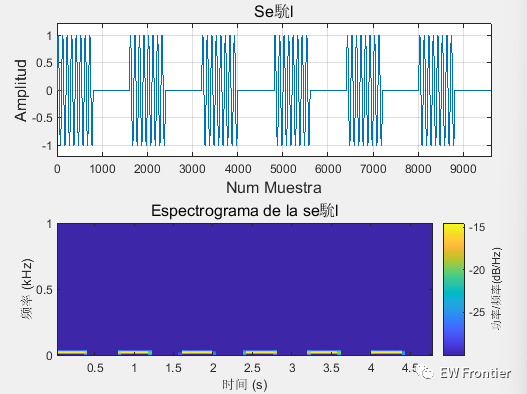
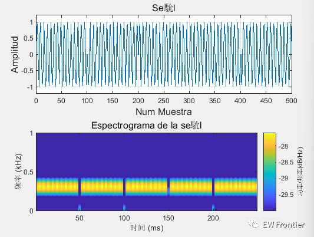
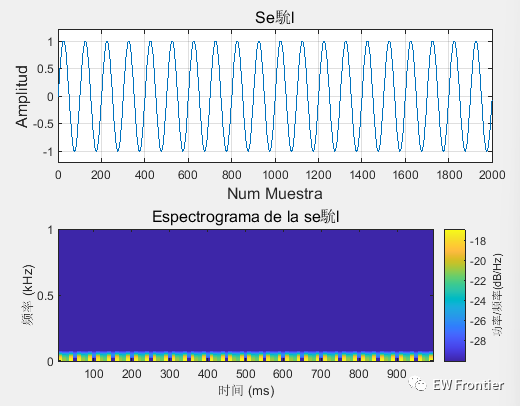
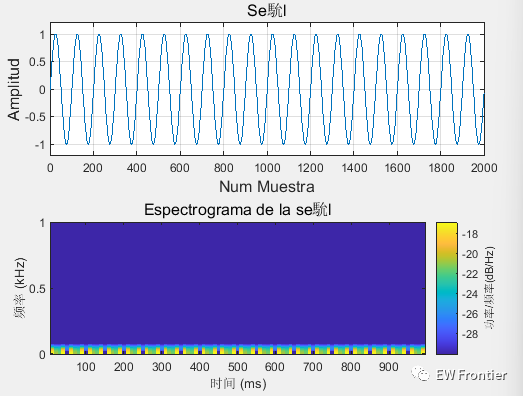
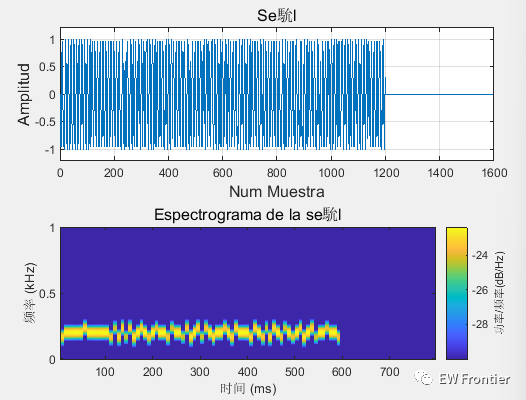
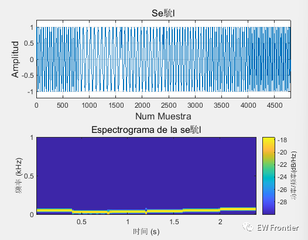
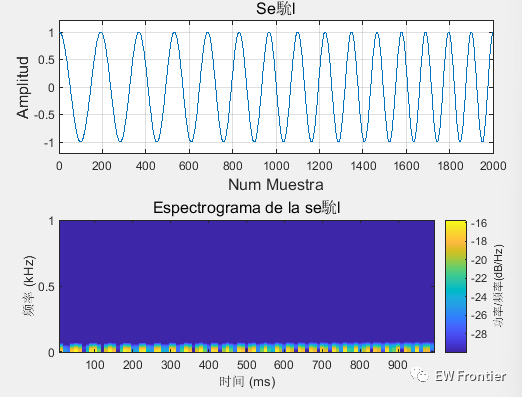

<!-- PAYMENT_BLOCK -->

## Get this dataset

- Payment link (Stripe): [Buy now](https://buy.stripe.com/3cs8yP7sY87d0vu9AB)
- Payment QR code: 

<!-- /PAYMENT_BLOCK -->
